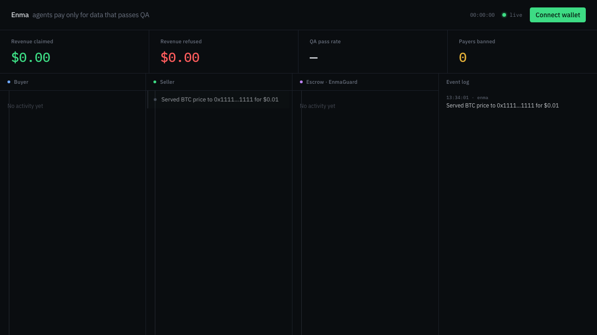
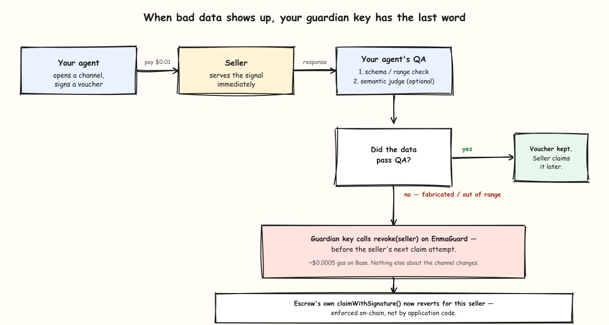
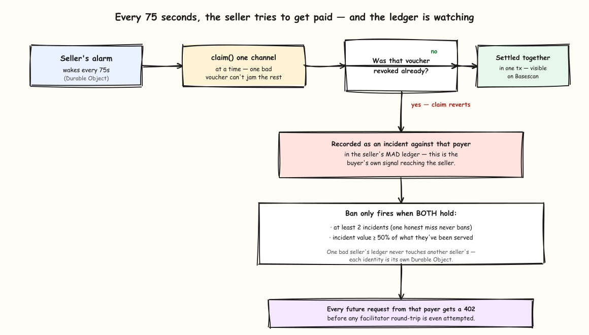
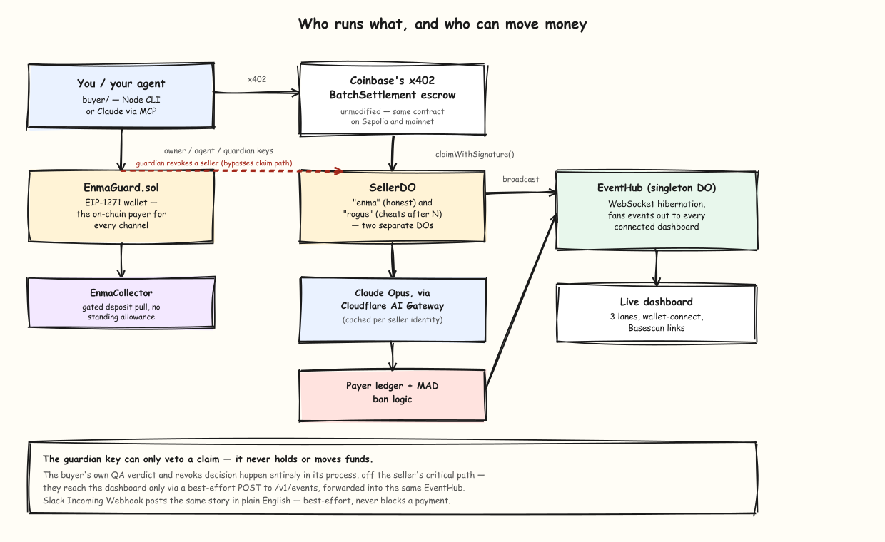

# Enma

**Agents pay only for data that passes QA.**

🔗 **Live on Cloudflare:** [enma.prabhupv.workers.dev](https://enma.prabhupv.workers.dev) ·
[dashboard](https://enma.prabhupv.workers.dev/dashboard.html)

Enma is an x402 batch-settlement marketplace between an AI buyer agent and a seller
(Cloudflare Worker + Durable Object), with an on-chain "revoke unclaimed vouchers if QA
fails" mechanism (`EnmaGuard.sol`, deployed on Base Sepolia). A buyer opens a pre-funded
payment channel, pays per request with signed vouchers, and runs its own two-gate QA
check (deterministic schema/invariants, then a semantic judge) on every response. If QA
fails, the buyer's guardian key revokes the voucher on-chain *before* the seller's next
claim — so bad data never gets paid for, without trusting the seller to self-police.

Built solo, test-driven, in one day for the Startup Speedrun hackathon.

---

## Connect your own agent

The [live site](https://enma.prabhupv.workers.dev) is now two pages: a landing page
pitching the mechanism, and a [dashboard](https://enma.prabhupv.workers.dev/dashboard.html)
that's wallet-aware. Connect a browser wallet and the seller (which already keys every
ledger entry by payer address, not by a hardcoded identity) will recognize you:

1. **Connect wallet** on the dashboard — any injected wallet (MetaMask, etc.) on Base
   Sepolia.
2. **Toggle "My activity"** to filter the live event feed down to just your address.
3. **Click "Connect your agent"** for a copy-paste MCP command and `.env` template to
   wire up your own buyer identity (see [Setup](#setup) below for the full on-chain
   deploy steps that go with it — generating your own `EnmaGuard`).



This is real client-side wallet auth against real live data, not a mock — what's not
built yet is one-click provisioning of a brand-new on-chain `EnmaGuard` per visitor
(today that's a manual Foundry deploy, see below).

### Use it from Claude directly

`buyer/src/mcp.ts` wraps the same buyer agent (real `openTab`, real voucher, real QA,
real revoke) as an MCP server — verified working over stdio. From `buyer/`:

```bash
claude mcp add enma -- npx tsx src/mcp.ts
```

Then in a Claude conversation: *"use Enma to buy the sentiment signal for AAPL."* Claude
calls `buy_signal` (or `cheat_signal` / `shady_signal` to demo the abuse paths) — the
exact same payment path the CLI drives, nothing mocked for the connector. Needs
`buyer/.env` filled in first (see Setup).

## Live demo

A static dashboard (`seller/public/dashboard.html`, served from Workers Assets) shows
the whole story in real time: 3 lanes (Buyer / Seller / Escrow), a live event feed,
revenue/QA/ban counters, and a Basescan link on every on-chain event. Deploy the seller
Worker and open `/dashboard.html` (the root URL is now the landing page), or run
locally:

```bash
cd seller && npm run dev     # wrangler dev, serves the API + the dashboard on :8787/dashboard.html
```

Then, from `buyer/`, drive a real purchase against it:

```bash
npx tsx scripts/runDemo.ts          # beats 1, 2, 3, 4, 6 (~30s, real Base Sepolia)
npx tsx scripts/runDemo.ts --mad    # beat 5 / MAD ban path (~4 min, waits out a real alarm cycle)
npx tsx scripts/runDemo.ts --all    # everything, in order
```

Or drive individual modes directly:

```bash
npx tsx src/cli.ts buy AAPL      # honest purchase
npx tsx src/cli.ts cheat AAPL    # pay for good data, revoke anyway (proves the ban path)
npx tsx src/cli.ts shady AAPL    # refuse a flagged seller before signing anything
```

## What the demo shows

| Beat | What happens |
|---|---|
| **The purchase** | 402 → open a channel → sign a voucher → `sentiment_index` → QA ✓ — all visible on the dashboard as it happens |
| **The cash-out** | The seller's own alarm (75s cadence) claims and settles on-chain; the claim tx lands on Basescan and the ops narrator posts it to Slack `#enma-ops` |
| **The save** | The rogue seller serves fabricated junk; QA catches it and the buyer's guardian key revokes the voucher on-chain, before the seller can ever claim it |
| **The revert** | The rogue seller's next claim attempt on that channel reverts at the escrow — Coinbase's own deployed contract enforces this, not application code |
| **MAD (ban)** | A "cheat" buyer pays for genuinely good data 3x and revokes anyway; the seller's ledger accumulates the incidents and bans the payer — the next request gets `402` (payment refused) before any facilitator round-trip |
| **Shady seller** | The buyer screens a seller's payout address against a local denylist and refuses before ever signing a voucher — no funds at risk even for a request that's never sent |

### The save — QA catches bad data, the guardian revokes it before payout



### The cash-out and the ban — how the MAD ledger actually decides



## Real, live-verified transactions (Base Sepolia)

| What | Tx |
|---|---|
| Voucher revoke (rogue seller's junk caught by QA → guardian revokes, beat 3) | [`0xd8f6f668...`](https://sepolia.basescan.org/tx/0xd8f6f6688e64ca625ccaa8514f7603a3ece3ddcb9eecfa516879860b3ca0eece) |
| Seller claim + settle (alarm cycle, beat 2) | [`0x4aa3ce51...`](https://sepolia.basescan.org/tx/0x4aa3ce516c483fcffc7e0793529107369532aec5b52df058b750e6446d4263e2) |
| MAD revoke (3 good-data channels wiped at once, beat 5) | [`0x6fea0429...`](https://sepolia.basescan.org/tx/0x6fea04291032d03d6a4665f151ab9cca7a76af9d53b6221b384b021e751d515f) |
| Guardian restore (clears a revocation) | [`0x47540cfa...`](https://sepolia.basescan.org/tx/0x47540cfa546875e2ebc266a82543b18b59eb67917f9c1869bfa5a33f6d17af68) |

All four from a single clean, timed, end-to-end rehearsal (`npx tsx scripts/runDemo.ts --all`, 2:34 total).

Measured gas (live, this network):

| Call | Gas used |
|---|---|
| `EnmaGuard.openTab` (fresh channel) | ~178,000 |
| `EnmaGuard.revoke` | 51,545 |
| `EnmaGuard.restore` | 28,379 |
| Facilitator claim + settle | 56,840 |

Base Sepolia gas is effectively free (faucet-funded); the facilitator pays claim gas.
Base mainnet gas was measured live at 0.006 gwei during planning — the same order of
magnitude as testnet.

## Architecture



Two independent seller identities ("enma" honest, "rogue" cheating) run as separate
Durable Object instances with separate on-chain receiver addresses, so revoking the
rogue seller never touches the honest seller's money. The buyer's QA verdicts and
revoke decisions happen entirely in its own process — they reach the dashboard via a
best-effort POST to `/v1/events`, forwarded to the same EventHub the sellers broadcast
into. The guardian key that revokes a seller never holds or moves funds — it only has
a veto, exercised directly against EnmaGuard, off the seller's normal claim path.

## Repo layout

```
Enma/
├── docs/                    # RESEARCH.md, PRD.md, PLAN.md (the full build plan), PLAN_EXPLAINED.md
├── contracts/                # Foundry: EnmaGuard.sol, EnmaCollector.sol, fork tests
├── shared/                   # zod schemas both sides import — signal shape, dashboard event shape
├── seller/                   # Cloudflare Worker + Durable Objects
│   ├── src/sellerDO.ts        # Hono + x402 + storage + alarm + event broadcast
│   ├── src/eventHub.ts        # WebSocket hibernation hub for the dashboard
│   ├── src/narrator.ts        # Slack Incoming Webhook ops notifier
│   ├── src/ledger.ts          # payer ledger, MAD bans
│   └── public/                # the dashboard itself (index.html/dashboard.js/dashboardLogic.js)
└── buyer/
    ├── src/agent.ts            # buy / cheat / shady modes
    ├── src/guardSigner.ts      # EIP-1271 voucher signer
    ├── src/qa.ts                # deterministic + Jev QA gates
    ├── src/mcp.ts               # MCP server (Claude can drive purchases directly)
    └── scripts/runDemo.ts       # the demo script above, runnable end-to-end
```

## Running the tests

```bash
cd seller && npm test    # 79 tests, no network required
cd buyer && npm test      # 37 tests (1 skipped — gated live e2e), no network required
```

Live/expensive tests are gated behind env flags and never run by default:
`RUN_G2=1` (seller ↔ facilitator integration), `RUN_E2E=1` (buyer end-to-end against
real Base Sepolia), `RUN_NARRATOR_SMOKE=1` (posts a real Slack message).

## Setup

See `docs/PHASE0_SETUP.md` for the full step-by-step (keys, RPC, contract deploy,
funding). The short version:

1. Deploy `EnmaGuard`/`EnmaCollector` (`contracts/`, Foundry) — already done for this
   deployment, address in `.env.example`.
2. **Fund `EnmaGuard` itself with USDC** — not the owner wallet. `openTab` pulls funds
   from the guard contract (it's the on-chain `payer` for every channel, per the
   EIP-1271 design), so the guard needs its own balance, separate from whatever the
   owner/agent/guardian keys hold. This is easy to miss and will fail every purchase
   with `ERC20: transfer amount exceeds balance` if forgotten.
3. `seller/`: copy `.env.example` → `.env`, fill in keys/addresses, generate
   `.dev.vars` (`grep -v "^#" .env | grep -v "^$" > .dev.vars`), `npm run dev`.
4. `buyer/`: copy `.env.example` → `.env`, fill in the same keys, `npx tsx scripts/runDemo.ts`.

## What's real vs. what's scoped down

- **Real**: the contract logic, the claim-time revocation mechanism, the batch
  settlement, the QA gates, the ban ledger, the dashboard — all live-verified against
  real Base Sepolia transactions, not mocked. Wallet-connect on the dashboard is real
  client-side wagmi/viem auth against the live event feed (the seller already keys
  ledger/ban state by payer address, so this needed no backend changes).
- **Scoped down for a one-day build**: Slack Incoming Webhook instead of a
  bidirectional Brainbase agent (Brainbase's own runtime send-message API turned out to
  be undocumented/task-based, not a push endpoint); no Stripe integration (the only
  documented crypto path needs manual account approval with no test-mode deposit
  helper); mainnet is a stretch goal, not required for the core demo — the contracts
  are proven identical on both networks, but testnet is a complete, honest demo on its
  own. Onboarding a new buyer identity is still a manual Foundry deploy (see Setup) —
  no one-click per-visitor wallet provisioning yet.

## Sponsor feedback

*(To fill in after the sponsor panel — notes from Coinbase/x402, Cloudflare, and any
other sponsors on the approach, what resonated, and what they'd want to see next.)*
